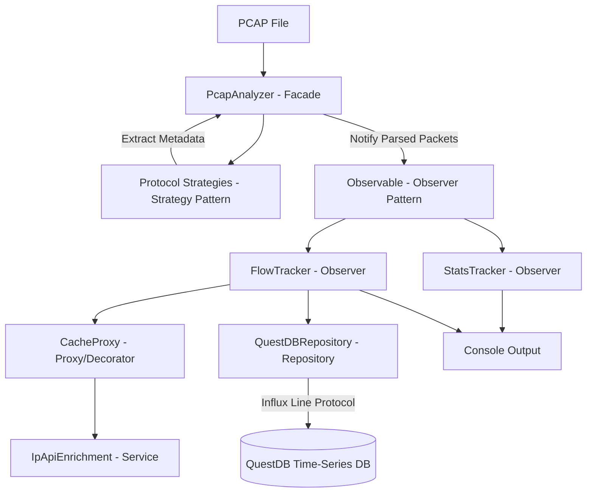

# ThesisWA - NetTelemetry 🚀

> **High-Performance, Design-Pattern-Driven Packet Capture (PCAP) Analytics & Storage Engine**

`NetTelemetry` is a modular, enterprise-grade Python application designed to parse, analyze, enrich, and store network traffic statistics from standard `.pcap` / `.pcapng` files. It leverages industry-standard software design patterns to provide protocol dissection (HTTP, TLS, DNS, raw payload), heuristic application/service classification, GeoIP/ASN enrichment, real-time statistics tracking, and time-series database ingestion into **QuestDB** with **Grafana** visualization support.

---

## 📋 Table of Contents

- [Features](#-features)
- [Architecture & Design Patterns](#-architecture--design-patterns)
- [Project Structure](#-project-structure)
- [Prerequisites](#-prerequisites)
- [Installation & Quick Start](#-installation--quick-start)
- [Usage Guide](#-usage-guide)
  - [Command-Line Options](#command-line-options)
  - [Generating & Downloading Test PCAPs](#generating--downloading-test-pcaps)
- [Configuration](#-configuration)
- [Database Schema & Ingestion](#-database-schema--ingestion)
- [Infrastructure (Docker Compose)](#-infrastructure-docker-compose)
- [Troubleshooting](#-troubleshooting)

---

## ✨ Features

- 🔍 **Deep Packet Inspection (DPI)**: Extracts protocol metadata using [PyShark](https://github.com/KimiNewt/pyshark) (Wireshark interface).
  - **TLS/SSL**: Server Name Indication (SNI) and TLS Record Versions.
  - **HTTP**: Request URIs, Host headers, Request Methods, and User-Agents.
  - **DNS**: Query names and resolved domain lookups.
  - **Payload**: Raw TCP/UDP ASCII payload preview extraction.
- 🏷️ **Heuristic App & Service Identification**: Maps port numbers, SNI extensions, and User-Agent strings to user applications (e.g., Google Chrome, Firefox, Meta, Netflix, Spotify).
- 🌍 **GeoIP & ASN Enrichment**: Queries `ip-api.com` to resolve external IP addresses to geographical locations (Country/City) and Organization/ASNs.
- ⚡ **Local Caching Layer**: High-speed JSON disk caching proxy (`enrichment_cache.json`) to minimize external API calls and rate-limiting.
- ⏱️ **Time-Series Ingestion**: High-throughput batch streaming into **QuestDB** via the InfluxDB Line Protocol (ILP HTTP).
- 📊 **Grafana Integration**: Pre-configured ports and services for building real-time dashboards.

---

## 🏗️ Architecture & Design Patterns

The codebase is built following clean architecture principles, adhering to **SOLID** guidelines and software engineering design patterns:



### Applied Design Patterns

| Pattern | Location | Description |
| :--- | :--- | :--- |
| **Singleton** | [`NetTelemetry/src/config/manager.py`](file:///c:/Users/cimin/Desktop/ThesisApps/NetTelemetry/src/config/manager.py) | **`ConfigManager`**: Thread-safe singleton providing centralized configuration management and environment variable loading. |
| **Strategy** | [`NetTelemetry/src/core/strategy.py`](file:///c:/Users/cimin/Desktop/ThesisApps/NetTelemetry/src/core/strategy.py) | **`ProtocolStrategy`**: Interface for protocol parsers (`TLSStrategy`, `HTTPStrategy`, `DNSStrategy`, `PayloadStrategy`). Allows adding new protocol decoders dynamically. |
| **Observer** | [`NetTelemetry/src/patterns/observer.py`](file:///c:/Users/cimin/Desktop/ThesisApps/NetTelemetry/src/patterns/observer.py), [`NetTelemetry/src/patterns/trackers.py`](file:///c:/Users/cimin/Desktop/ThesisApps/NetTelemetry/src/patterns/trackers.py) | **`Observable` & `PacketObserver`**: Decouples packet parsing from packet consumption (`StatsTracker` and `FlowTracker`). |
| **Facade** | [`NetTelemetry/src/core/analyzer.py`](file:///c:/Users/cimin/Desktop/ThesisApps/NetTelemetry/src/core/analyzer.py) | **`PcapAnalyzer`**: Provides a unified entry point to hide complex PyShark packet loop handling and strategy execution. |
| **Proxy / Decorator** | [`NetTelemetry/src/enrichment/service.py`](file:///c:/Users/cimin/Desktop/ThesisApps/NetTelemetry/src/enrichment/service.py) | **`CacheProxy`**: Wraps `IpApiEnrichment` to transparently cache IP geolocation results locally, eliminating duplicate network lookups. |
| **Repository** | [`NetTelemetry/src/storage/questdb_repo.py`](file:///c:/Users/cimin/Desktop/ThesisApps/NetTelemetry/src/storage/questdb_repo.py) | **`QuestDBRepository`**: Encapsulates persistence logic, batching records and transmitting them over ILP HTTP. |
| **Service (Singleton-like)** | [`NetTelemetry/src/patterns/domain_categorizer.py`](file:///c:/Users/cimin/Desktop/ThesisApps/NetTelemetry/src/patterns/domain_categorizer.py) | **`DomainCategorizer`**: Manages a local cache for domain categories, enabling fast O(1) queries without network overhead for UT1 blacklists. |

---

## 📁 Project Structure

```text
ThesisWA/
└── NetTelemetry/
    ├── compose.yml              # Docker Compose configuration (QuestDB + Grafana)
    ├── requirements.txt         # Python project dependencies
    ├── main.py                  # CLI application entrypoint (Single PCAP processing)
    ├── extract.py               # Extracts basic metadata using tshark
    ├── reprocess.py             # Script to reprocess cached JSON outputs
    ├── run_all.py               # Orchestrator to process a batch of PCAP files
    ├── _debug_data.py           # Utility to clean debug data/caches
    ├── enrichment_cache.json    # Auto-generated GeoIP lookup cache
    ├── grafana/                 # Automatic Grafana provisioning configs
    │   └── provisioning/
    │       ├── datasources/     # Auto-configures QuestDB data source
    │       └── dashboards/      # Pre-loaded PCAP Analytics dashboard
    ├── src/
    │   ├── config/
    │   │   └── manager.py       # Thread-safe ConfigManager Singleton
    │   ├── core/
    │   │   ├── analyzer.py      # PcapAnalyzer Facade
    │   │   └── strategy.py      # Protocol extraction Strategies (TLS, HTTP, DNS, Payload)
    │   ├── enrichment/
    │   │   └── service.py       # IpApiEnrichment & CacheProxy
    │   ├── patterns/
    │   │   ├── domain_categorizer.py # Domain categorizer using UT1 blacklists
    │   │   ├── observer.py      # Observable & PacketObserver abstractions
    │   │   └── trackers.py      # StatsTracker & FlowTracker implementations
    │   └── storage/
    │       └── questdb_repo.py  # QuestDB Repository (InfluxDB Line Protocol)
    └── tests/                   # Automated Unit Tests & PCAP Generators
        ├── test_config.py       # Unit tests for ConfigManager
        ├── test_trackers.py     # Unit tests for StatsTracker and FlowTracker
        ├── download_sample.py   # Utility script: Downloads standard HTTP sample capture
        ├── generate_pcap.py     # Utility script: Simple PCAP generator (Scapy)
        ├── generate_full_pcap.py# Utility script: Multi-protocol PCAP generator (Scapy)
        └── pcaps/               # Directory containing test .pcap captures
```

---

## 🛠️ Prerequisites

Before running `NetTelemetry`, ensure your system meets the following requirements:

1. **Python 3.8+**
2. **Wireshark / TShark**: PyShark relies on `tshark` CLI for packet dissection.
   - **Windows**: Install [Wireshark](https://www.wireshark.org/) and ensure `tshark.exe` is added to your system `PATH`.
   - **Linux (Ubuntu/Debian)**: `sudo apt update && sudo apt install -y tshark`
   - **macOS**: `brew install wireshark`
3. **Docker & Docker Compose** (Optional, required for QuestDB & Grafana database storage and visualization).

---

## ⚙️ Installation & Quick Start

### 1. Clone & Navigate to Project Directory

```bash
git clone https://github.com/Rafxf04/ThesisWA.git
cd ThesisWA/NetTelemetry
```

### 2. Set Up Virtual Environment

```bash
# Create virtual environment
python -m venv venv

# Activate virtual environment
# Windows (PowerShell):
.\venv\Scripts\Activate.ps1
# Linux/macOS:
source venv/bin/activate
```

### 3. Install Dependencies

```bash
pip install -r requirements.txt
```

*(Note: For test script generation using `Scapy`, you can optionally install `pip install scapy`)*

### 4. Launch Infrastructure Services (QuestDB & Grafana)

First, make sure the Docker application (e.g., Docker Desktop) is running on your system, then run the following command to start the containers:

```bash
docker compose up -d
```

Confirm services are running:
- **QuestDB Web Console**: [http://localhost:9000](http://localhost:9000)
- **Grafana Dashboard**: [http://localhost:3000](http://localhost:3000) *(User: `admin`, Password: `admin`)*

---

## 🚀 Usage Guide

### Basic Execution

Run analysis on a sample PCAP file with default settings (Geolocation + QuestDB enabled):

```bash
python main.py -pcap sample.pcap
```

### Command-Line Options

```text
usage: main.py [-h] -pcap PCAP [--no-db] [--no-enrich]

NetTelemetry - PCAP Analytics & Storage Engine

optional arguments:
  -h, --help    show this help message and exit
  -pcap PCAP    Path to the input PCAP/PCAPNG file (Required)
  --no-db       Disable QuestDB export (Runs in offline/standalone mode)
  --no-enrich   Disable external IP-API geolocation lookups
```

#### Run in Standalone Mode (No Database Ingestion)

```bash
python main.py -pcap full_sample.pcap --no-db
```

#### Run without Geolocation API Lookups

```bash
python main.py -pcap full_sample.pcap --no-enrich
```

### Running Unit Tests & Generating Test PCAPs

Make sure you are in the `NetTelemetry` project directory with the virtual environment activated:

```bash
cd NetTelemetry
```

1. **Run Automated Unit Tests**:
   - **From `NetTelemetry` directory**:
     ```bash
     python -m unittest discover -s tests
     ```
   - **From root workspace directory (`ThesisApps`)**:
     ```bash
     python -m unittest discover -s NetTelemetry/tests -t NetTelemetry
     ```

2. **Download standard Wireshark HTTP sample**:
   ```bash
   python tests/download_sample.py
   # Creates: tests/pcaps/sample.pcap
   ```

3. **Generate Synthetic Multi-Protocol PCAP (HTTP, TLS SNI, DNS)**:
   ```bash
   python tests/generate_full_pcap.py
   # Creates: tests/pcaps/full_sample.pcap
   ```

---

## ⚙️ Configuration

Application settings can be configured via environment variables or modified directly in `src/config/manager.py`:

| Variable | Default Value | Description |
| :--- | :--- | :--- |
| `QUESTDB_HOST` | `127.0.0.1` | QuestDB host address |
| `QUESTDB_PORT` / `QUESTDB_ILP_PORT` | `9009` | QuestDB Influx Line Protocol (ILP) TCP port (Not actively used, fallback) |
| `QUESTDB_HTTP_PORT` | `9000` | QuestDB REST API / Web Console port |

Example running with custom QuestDB host:

```bash
$env:QUESTDB_HOST="192.168.1.100"; python main.py -pcap full_sample.pcap
```

---

## 🗄️ Database Schema & Ingestion

Data is streamed into QuestDB in batches under the `network_traffic` table using high-precision nanosecond packet timestamps.

### QuestDB Table: `network_traffic`

| Column Name | Type | Description |
| :--- | :--- | :--- |
| `timestamp` | Timestamp (Designated) | High-precision nanosecond timestamp from PCAP capture |
| `protocol` | Symbol | Transport/Application protocol (e.g. `TCP`, `UDP`, `TLS`) |
| `service_name` | Symbol | Inferred application layer service (e.g. `HTTP`, `HTTPS`, `DNS`) |
| `src_ip` | Symbol | Source IP address |
| `dst_ip` | Symbol | Destination IP address |
| `src_app_name` | Symbol | Inferred source application or organization |
| `dst_app_name` | Symbol | Inferred destination application or domain organization |
| `geo_country` | Symbol | Geolocation country name for destination IP |
| `src_port` | Long / Int | Source port number |
| `dst_port` | Long / Int | Destination port number |
| `length` | Long / Int | Total packet length (bytes) |
| `tls_sni` | String | Server Name Indication (TLS Handshake extension) |
| `payload_len` | Long / Int | Length of payload content |

### Querying in QuestDB Console (`http://localhost:9000`)

```sql
-- View recent traffic flows
SELECT timestamp, src_ip, dst_ip, service_name, dst_app_name, geo_country, length 
FROM network_traffic 
ORDER BY timestamp DESC;

-- Protocol byte summary
SELECT protocol, count(*), sum(length) as total_bytes 
FROM network_traffic 
SAMPLE BY 1m;
```

---

## 🐳 Infrastructure (Docker Compose)

The included [`compose.yml`](file:///c:/Users/cimin/Desktop/ThesisApps/NetTelemetry/compose.yml) provisions:

- **QuestDB**:
  - `9000`: Web Console & REST API
  - `9009`: InfluxDB Line Protocol (TCP - available but unused in current code)
  - `8812`: Postgres Wire Protocol
- **Grafana**:
  - `3000`: Web UI (Default credentials: `admin` / `admin`)
  - **Automatic Provisioning**: Pre-configures the QuestDB plugin data source and loads the **NetTelemetry - PCAP Analytics Dashboard** on startup with auto-configured time ranges (`Last 5 years`), eliminating manual UI setup.

To stop infrastructure services (preserving saved data and configurations):

```bash
docker compose down
```

---

## ❓ Troubleshooting

### 1. `PyShark: tshark is not found` or `FileNotFoundError`
- **Cause**: PyShark cannot locate the `tshark` executable.
- **Fix**: Ensure Wireshark is installed and add `C:\Program Files\Wireshark` (Windows) to system environment variables (`PATH`), then restart your terminal.

### 2. `QuestDB connection offline/unavailable at 127.0.0.1:9000`
- **Cause**: QuestDB container is not running or port `9000` is blocked.
- **Fix**: Verify Docker status using `docker ps`. Run `docker compose up -d` to start QuestDB. If you don't want DB storage, pass the `--no-db` flag to `main.py`.

### 3. `ip-api.com HTTP 429 Too Many Requests`
- **Cause**: Reached rate limit on external free API lookups.
- **Fix**: The built-in `CacheProxy` stores lookup results in `enrichment_cache.json`. Subsequent runs on the same IPs will use the disk cache automatically.

---

## 📄 License

This project is open-source and intended for network telemetry, research, and educational purposes.
